# Kết quả benchmark model embedding

Tạo bởi `evaluation_new/benchmark_models.ipynb`. Test 52 ảnh (47 `has_match`), validation 23 ảnh.

- C2_embedding_only · hit_at_5: cao nhất **Marqo-FashionSigLIP** 0.468 (FashionCLIP 0.362)
- C2_embedding_only · mrr_at_5: cao nhất **Marqo-FashionSigLIP** 0.330 (FashionCLIP 0.277)
- C2_embedding_only · judged_hit_at_5: cao nhất **Marqo-FashionSigLIP** 0.489 (FashionCLIP 0.362)
- B0_current · hit_at_5: cao nhất **FashionCLIP (hiện tại)** 0.426 (FashionCLIP 0.426)
- B0_current · mrr_at_5: cao nhất **Marqo-FashionCLIP** 0.370 (FashionCLIP 0.360)
- B0_current · judged_hit_at_5: cao nhất **Marqo-FashionCLIP** 0.447 (FashionCLIP 0.426)

## Bảng test

| config | model_label | dimension | hit_at_5 | mrr_at_5 | precision_at_5 | joint_at_5 | candidate_hit_at_100 | judged_hit_at_5 | judged_mrr_at_5 | unjudged_at_5 | target_recall | embed_ms_mean |
|---|---|---|---|---|---|---|---|---|---|---|---|---|
| A0_whole_image | FashionCLIP (vector gốc) | 512 | 0.340 | 0.214 | 0.111 | 0.431 | 0.851 | 0.340 | 0.214 | 0 |  | 27.384 |
| A0_whole_image | FashionCLIP (hiện tại) | 512 | 0.340 | 0.214 | 0.111 | 0.431 | 0.851 | 0.340 | 0.214 | 0 |  | 25.917 |
| A0_whole_image | Marqo-FashionCLIP | 512 | 0.319 | 0.217 | 0.115 | 0.353 | 0.915 | 0.340 | 0.242 | 113 |  | 57.012 |
| A0_whole_image | OpenAI CLIP ViT-B/16 | 512 | 0.170 | 0.129 | 0.064 | 0.255 | 0.745 | 0.277 | 0.191 | 170 |  | 59.689 |
| A0_whole_image | LAION CLIP ViT-B/32 | 512 | 0.340 | 0.202 | 0.102 | 0.373 | 0.830 | 0.404 | 0.241 | 57 |  | 25.286 |
| A0_whole_image | Marqo-FashionSigLIP | 768 | 0.511 | 0.312 | 0.166 | 0.510 | 0.851 | 0.574 | 0.424 | 140 |  | 59.415 |
| A0_whole_image | SigLIP ViT-B/16 | 768 | 0.404 | 0.215 | 0.132 | 0.373 | 0.872 | 0.468 | 0.302 | 144 |  | 60.747 |
| A0_whole_image | DINOv2 ViT-B/14 | 768 | 0.213 | 0.134 | 0.055 | 0.255 | 0.681 | 0.340 | 0.289 | 194 |  | 92.670 |
| C2_embedding_only | FashionCLIP (vector gốc) | 512 | 0.362 | 0.277 | 0.187 | 0.392 | 0.511 | 0.362 | 0.277 | 0 | 0.519 | 295.573 |
| C2_embedding_only | FashionCLIP (hiện tại) | 512 | 0.362 | 0.277 | 0.187 | 0.392 | 0.511 | 0.362 | 0.277 | 0 | 0.519 | 277.095 |
| C2_embedding_only | Marqo-FashionCLIP | 512 | 0.404 | 0.325 | 0.187 | 0.373 | 0.511 | 0.447 | 0.346 | 31 | 0.519 | 739.783 |
| C2_embedding_only | OpenAI CLIP ViT-B/16 | 512 | 0.170 | 0.113 | 0.077 | 0.176 | 0.489 | 0.277 | 0.172 | 77 | 0.519 | 532.390 |
| C2_embedding_only | LAION CLIP ViT-B/32 | 512 | 0.362 | 0.265 | 0.149 | 0.373 | 0.532 | 0.362 | 0.266 | 17 | 0.519 | 269.343 |
| C2_embedding_only | Marqo-FashionSigLIP | 768 | 0.468 | 0.330 | 0.191 | 0.431 | 0.511 | 0.489 | 0.363 | 39 | 0.519 | 888.557 |
| C2_embedding_only | SigLIP ViT-B/16 | 768 | 0.340 | 0.261 | 0.140 | 0.333 | 0.532 | 0.383 | 0.307 | 53 | 0.519 | 540.917 |
| C2_embedding_only | DINOv2 ViT-B/14 | 768 | 0.213 | 0.102 | 0.064 | 0.216 | 0.468 | 0.319 | 0.213 | 89 | 0.519 | 742.619 |
| B0_current | FashionCLIP (vector gốc) | 512 | 0.426 | 0.360 | 0.221 | 0.412 | 0.511 | 0.426 | 0.360 | 0 | 0.519 | 295.573 |
| B0_current | FashionCLIP (hiện tại) | 512 | 0.426 | 0.360 | 0.221 | 0.412 | 0.511 | 0.426 | 0.360 | 0 | 0.519 | 277.095 |
| B0_current | Marqo-FashionCLIP | 512 | 0.426 | 0.370 | 0.200 | 0.412 | 0.511 | 0.447 | 0.403 | 29 | 0.519 | 739.783 |
| B0_current | OpenAI CLIP ViT-B/16 | 512 | 0.319 | 0.233 | 0.123 | 0.333 | 0.489 | 0.340 | 0.267 | 59 | 0.519 | 532.390 |
| B0_current | LAION CLIP ViT-B/32 | 512 | 0.362 | 0.319 | 0.166 | 0.392 | 0.532 | 0.383 | 0.323 | 15 | 0.519 | 269.343 |
| B0_current | Marqo-FashionSigLIP | 768 | 0.426 | 0.358 | 0.179 | 0.392 | 0.511 | 0.426 | 0.385 | 35 | 0.519 | 888.557 |
| B0_current | SigLIP ViT-B/16 | 768 | 0.404 | 0.310 | 0.157 | 0.392 | 0.532 | 0.404 | 0.340 | 40 | 0.519 | 540.917 |
| C3_selected | FashionCLIP (vector gốc) | 512 | 0.426 | 0.356 | 0.234 | 0.412 | 0.511 | 0.426 | 0.356 | 0 | 0.519 | 295.573 |
| C3_selected | FashionCLIP (hiện tại) | 512 | 0.426 | 0.356 | 0.234 | 0.412 | 0.511 | 0.426 | 0.356 | 0 | 0.519 | 277.095 |
| C3_selected | Marqo-FashionCLIP | 512 | 0.404 | 0.355 | 0.191 | 0.392 | 0.511 | 0.447 | 0.394 | 29 | 0.519 | 739.783 |
| C3_selected | OpenAI CLIP ViT-B/16 | 512 | 0.319 | 0.226 | 0.128 | 0.314 | 0.489 | 0.340 | 0.270 | 58 | 0.519 | 532.390 |
| C3_selected | LAION CLIP ViT-B/32 | 512 | 0.362 | 0.305 | 0.166 | 0.392 | 0.532 | 0.404 | 0.313 | 14 | 0.519 | 269.343 |
| C3_selected | Marqo-FashionSigLIP | 768 | 0.426 | 0.357 | 0.174 | 0.392 | 0.511 | 0.447 | 0.390 | 34 | 0.519 | 888.557 |
| C3_selected | SigLIP ViT-B/16 | 768 | 0.404 | 0.310 | 0.162 | 0.392 | 0.532 | 0.404 | 0.340 | 38 | 0.519 | 540.917 |

## So từng truy vấn với FashionCLIP (test)

| split | config | model | win | loss | tie | sign_test_p |
|---|---|---|---|---|---|---|
| test | A0_whole_image | clip_b16 | 7 | 11 | 29 | 0.481 |
| test | A0_whole_image | dinov2_base | 5 | 13 | 29 | 0.096 |
| test | A0_whole_image | fashionclip_stored | 0 | 0 | 47 | 1.000 |
| test | A0_whole_image | laion_b32 | 5 | 8 | 34 | 0.581 |
| test | A0_whole_image | marqo_fashionclip | 6 | 8 | 33 | 0.791 |
| test | A0_whole_image | marqo_fashionsiglip | 13 | 7 | 27 | 0.263 |
| test | A0_whole_image | siglip_b16 | 11 | 11 | 25 | 1.000 |
| test | B0_current | clip_b16 | 1 | 10 | 36 | 0.012 |
| test | B0_current | fashionclip_stored | 0 | 0 | 47 | 1.000 |
| test | B0_current | laion_b32 | 2 | 6 | 39 | 0.289 |
| test | B0_current | marqo_fashionclip | 3 | 3 | 41 | 1.000 |
| test | B0_current | marqo_fashionsiglip | 4 | 2 | 41 | 0.688 |
| test | B0_current | siglip_b16 | 2 | 6 | 39 | 0.289 |
| test | C2_embedding_only | clip_b16 | 1 | 13 | 33 | 0.002 |
| test | C2_embedding_only | dinov2_base | 2 | 13 | 32 | 0.007 |
| test | C2_embedding_only | fashionclip_stored | 0 | 0 | 47 | 1.000 |
| test | C2_embedding_only | laion_b32 | 5 | 5 | 37 | 1.000 |
| test | C2_embedding_only | marqo_fashionclip | 7 | 5 | 35 | 0.774 |
| test | C2_embedding_only | marqo_fashionsiglip | 11 | 4 | 32 | 0.118 |
| test | C2_embedding_only | siglip_b16 | 8 | 8 | 31 | 1.000 |
| test | C3_selected | clip_b16 | 2 | 10 | 35 | 0.039 |
| test | C3_selected | fashionclip_stored | 0 | 0 | 47 | 1.000 |
| test | C3_selected | laion_b32 | 2 | 6 | 39 | 0.289 |
| test | C3_selected | marqo_fashionclip | 4 | 4 | 39 | 1.000 |
| test | C3_selected | marqo_fashionsiglip | 4 | 3 | 40 | 1.000 |
| test | C3_selected | siglip_b16 | 3 | 6 | 38 | 0.508 |

## Biểu đồ

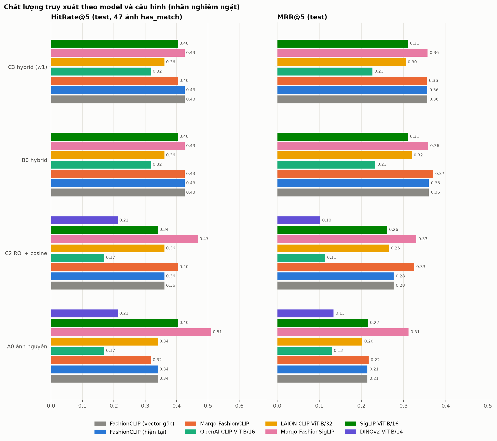
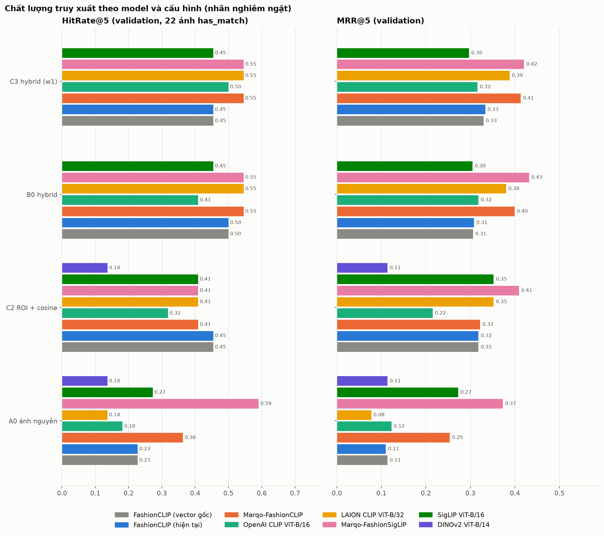
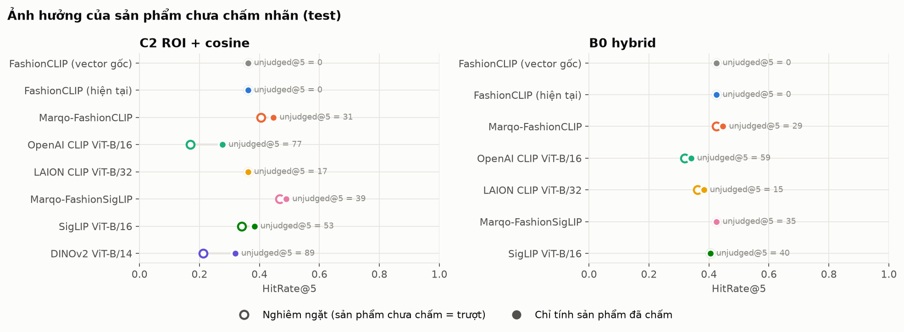
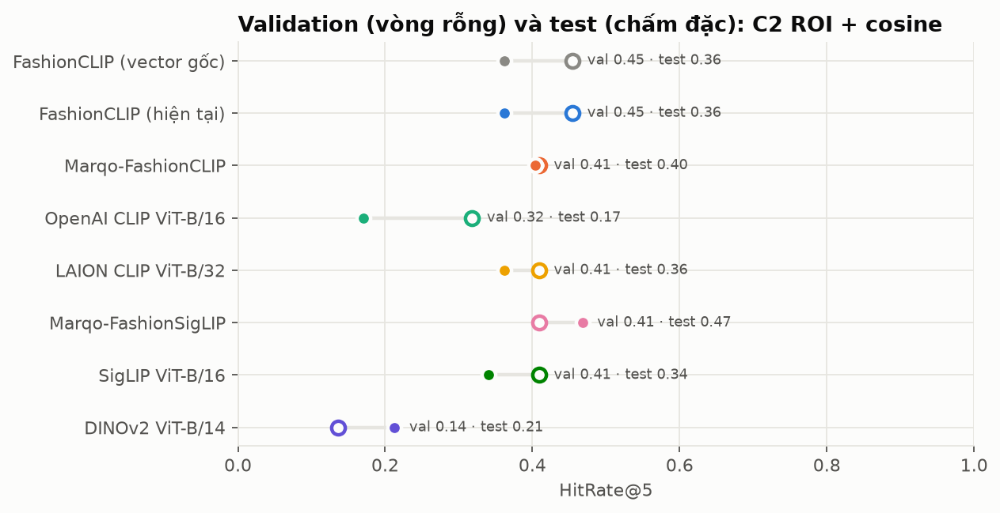
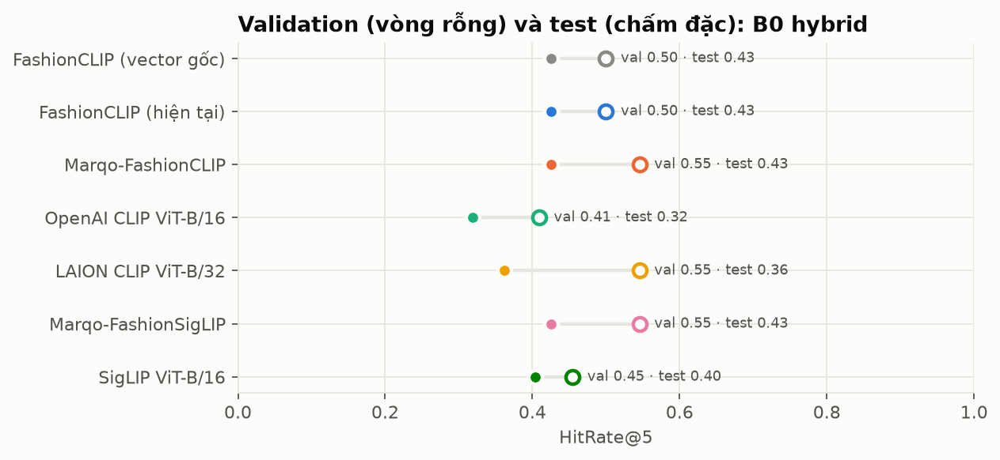
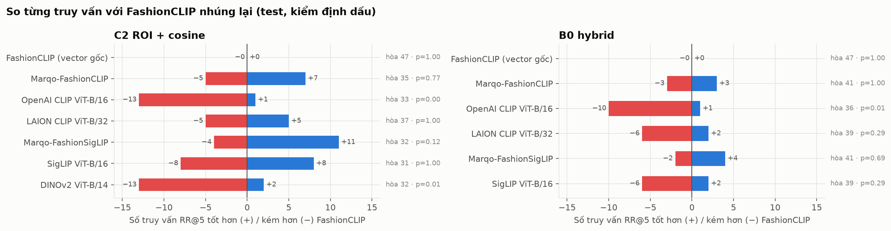
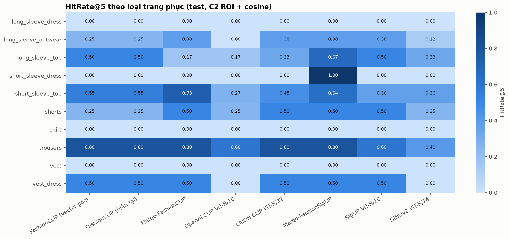
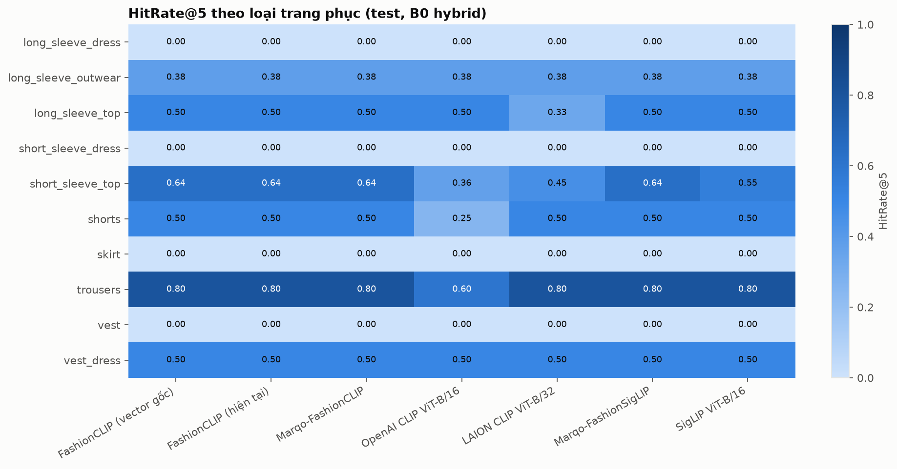
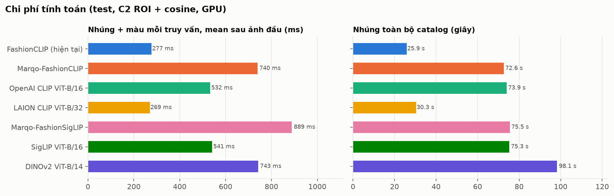
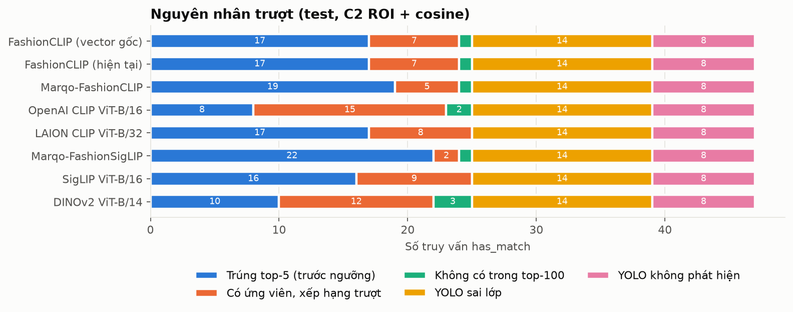
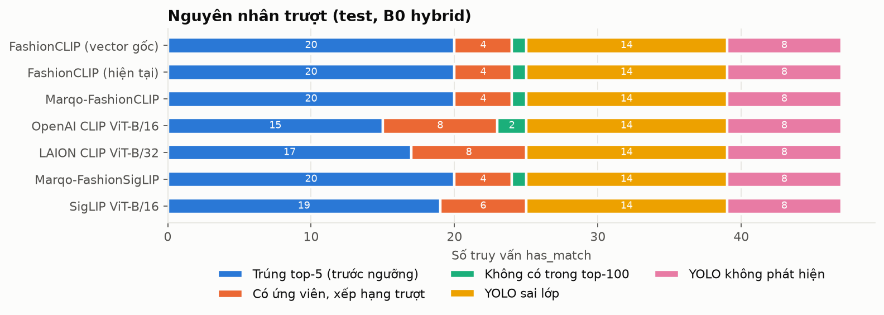

## Lưu ý

- Nhãn chỉ phủ sản phẩm từng được chấm (chủ yếu từ FashionCLIP). Sản phẩm chưa chấm tính là trượt, nên số nghiêm ngặt thiên vị FashionCLIP; xem `unjudged_at_5` và `judged_*`.
- 47 truy vấn has_match: chênh 1 truy vấn = 0,021 HitRate. Dùng p của kiểm định dấu trước khi kết luận.
- Ngưỡng chấp nhận (0,70 / 0,60) được chỉnh cho FashionCLIP, nên chỉ số sau ngưỡng không so sánh được giữa các model; bảng chỉ dùng chỉ số trước ngưỡng.
- Phát hiện (YOLO) giống hệt nhau ở mọi model nên `target_recall` không đổi.