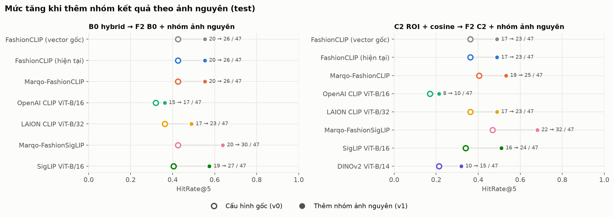
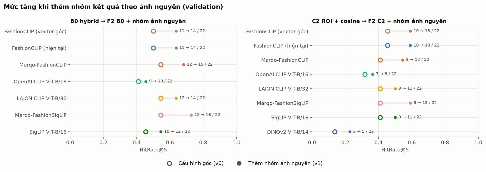
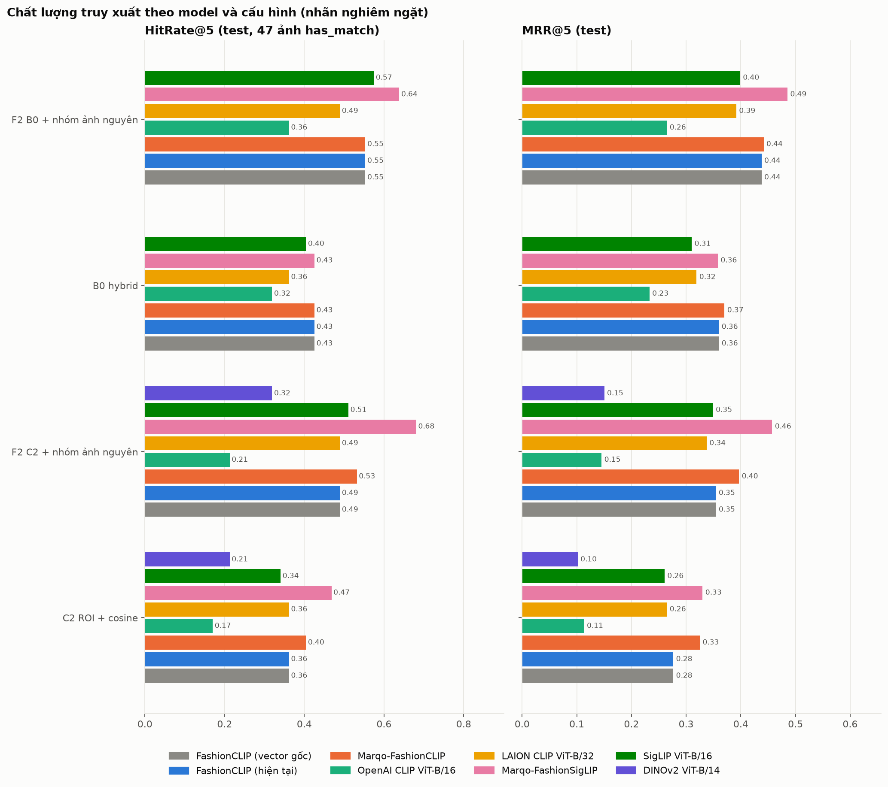
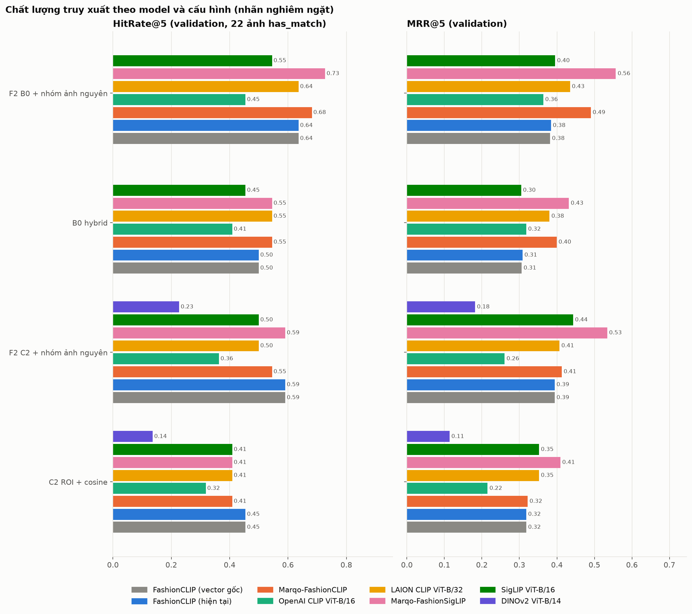
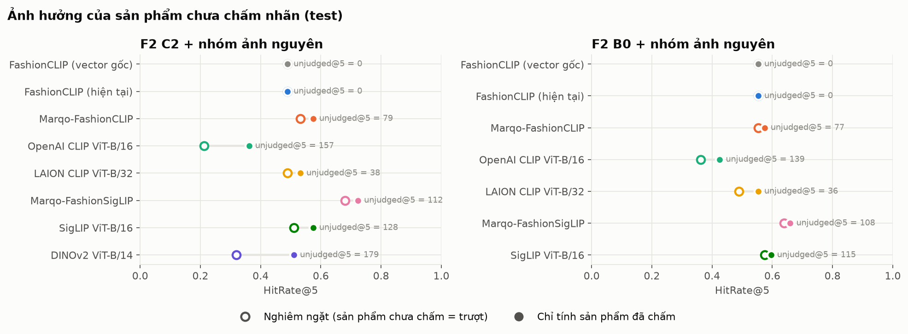
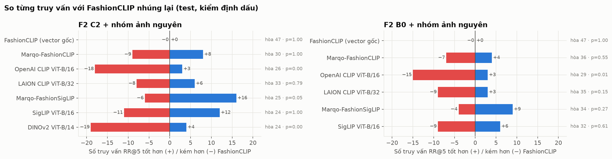
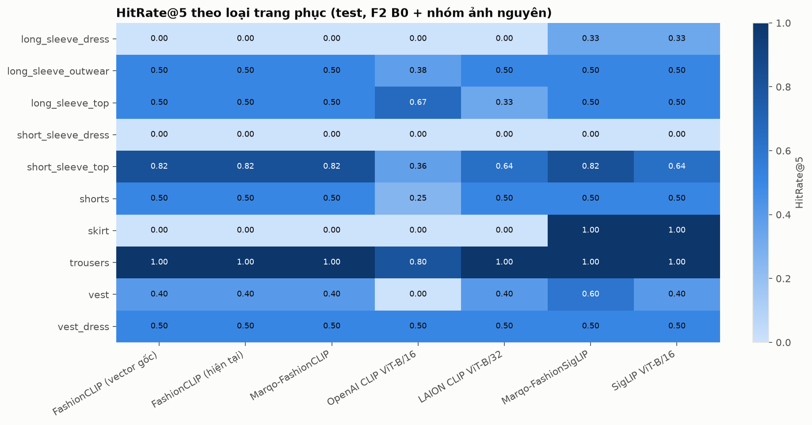
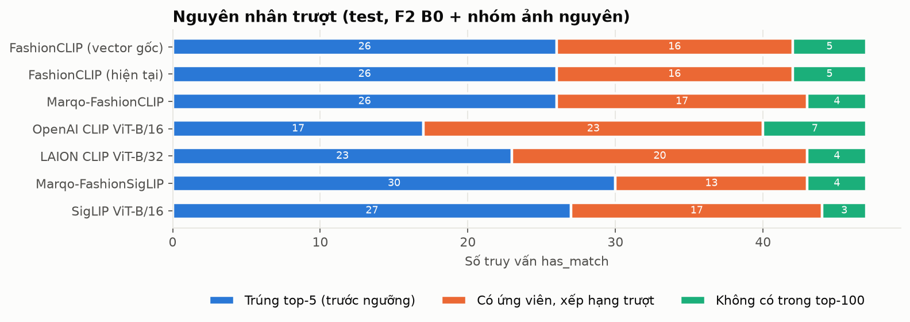
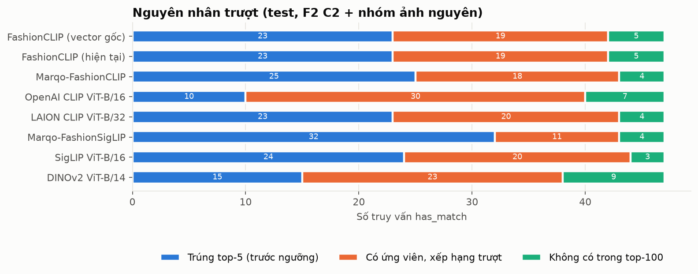
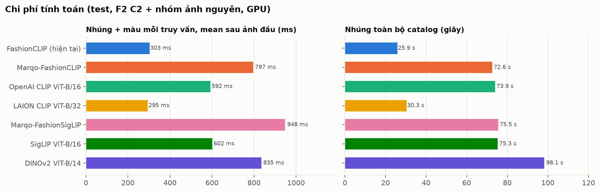

# Benchmark v1: thêm nhóm kết quả theo ảnh nguyên

Tạo bởi `evaluation_new/benchmark_v1.ipynb`. Test 52 ảnh (47 `has_match`, 4 `no_match`), validation 23 ảnh.
Khóa trên validation lúc 2026-11-24T15:38:21.856791+00:00; cấu hình chính đã khóa: **F2_B0_whole**.

## Định nghĩa

- `F1_B0_nodet`: B0; YOLO không trả hộp nào thì tìm bằng ảnh nguyên. Không bao giờ kích hoạt vì YOLO luôn trả ít nhất một hộp (75/75 ảnh).
- `F2_B0_whole` / `F2_C2_whole`: các nhóm theo món của B0 / C2, cộng một nhóm "ảnh nguyên" (cosine như A0, qua ngưỡng production 0,70 / 0,60).
- Nhóm người dùng chọn: nhóm YOLO đúng lớp và IoU ≥ 0,5 nếu có, nếu không thì nhóm ảnh nguyên (cùng giả định với v0).

## HitRate@5 · MRR@5 trên tập test

| Model | C2 | F2_C2_whole | B0 | F2_B0_whole |
|---|---|---|---|---|
| FashionCLIP (hiện tại) | 17/47 · 0.277 | 23/47 · 0.355 | 20/47 · 0.360 | 26/47 · 0.438 |
| Marqo-FashionCLIP | 19/47 · 0.325 | 25/47 · 0.397 | 20/47 · 0.370 | 26/47 · 0.442 |
| OpenAI CLIP ViT-B/16 | 8/47 · 0.113 | 10/47 · 0.145 | 15/47 · 0.233 | 17/47 · 0.265 |
| LAION CLIP ViT-B/32 | 17/47 · 0.265 | 23/47 · 0.338 | 17/47 · 0.319 | 23/47 · 0.392 |
| Marqo-FashionSigLIP | 22/47 · 0.330 | 32/47 · 0.457 | 20/47 · 0.358 | 30/47 · 0.485 |
| SigLIP ViT-B/16 | 16/47 · 0.261 | 24/47 · 0.349 | 19/47 · 0.310 | 27/47 · 0.399 |
| DINOv2 ViT-B/14 | 10/47 · 0.102 | 15/47 · 0.150 | — | — |

## Validation

| Model | C2 | F2_C2_whole | B0 | F2_B0_whole |
|---|---|---|---|---|
| FashionCLIP (hiện tại) | 10/22 · 0.318 | 13/22 · 0.394 | 11/22 · 0.308 | 14/22 · 0.384 |
| Marqo-FashionCLIP | 9/22 · 0.322 | 12/22 · 0.413 | 12/22 · 0.399 | 15/22 · 0.490 |
| OpenAI CLIP ViT-B/16 | 7/22 · 0.215 | 8/22 · 0.261 | 9/22 · 0.318 | 10/22 · 0.364 |
| LAION CLIP ViT-B/32 | 9/22 · 0.352 | 11/22 · 0.407 | 12/22 · 0.380 | 14/22 · 0.435 |
| Marqo-FashionSigLIP | 9/22 · 0.409 | 13/22 · 0.534 | 12/22 · 0.432 | 16/22 · 0.557 |
| SigLIP ViT-B/16 | 9/22 · 0.352 | 11/22 · 0.443 | 10/22 · 0.305 | 12/22 · 0.395 |
| DINOv2 ViT-B/14 | 3/22 · 0.114 | 5/22 · 0.182 | — | — |

## False acceptance trên 4 ảnh `no_match` (test, sau ngưỡng)

| Model | B0 | F2_B0_whole |
|---|---|---|
| FashionCLIP (hiện tại) | 0/4 | 0/4 |
| Marqo-FashionCLIP | 0/4 | 0/4 |
| OpenAI CLIP ViT-B/16 | 0/4 | 0/4 |
| LAION CLIP ViT-B/32 | 0/4 | 0/4 |
| Marqo-FashionSigLIP | 1/4 | 2/4 |
| SigLIP ViT-B/16 | 1/4 | 1/4 |

## Bảng test đầy đủ

| config | model_label | dimension | hit_at_5 | mrr_at_5 | precision_at_5 | joint_at_5 | candidate_hit_at_100 | judged_hit_at_5 | judged_mrr_at_5 | unjudged_at_5 | target_recall | embed_ms_mean |
|---|---|---|---|---|---|---|---|---|---|---|---|---|
| A0_whole_image | FashionCLIP (vector gốc) | 512 | 0.340 | 0.214 | 0.111 | 0.431 | 0.851 | 0.340 | 0.214 | 0 |  | 27.384 |
| A0_whole_image | FashionCLIP (hiện tại) | 512 | 0.340 | 0.214 | 0.111 | 0.431 | 0.851 | 0.340 | 0.214 | 0 |  | 25.917 |
| A0_whole_image | Marqo-FashionCLIP | 512 | 0.319 | 0.217 | 0.115 | 0.353 | 0.915 | 0.340 | 0.242 | 113 |  | 57.012 |
| A0_whole_image | OpenAI CLIP ViT-B/16 | 512 | 0.170 | 0.129 | 0.064 | 0.255 | 0.745 | 0.277 | 0.191 | 170 |  | 59.689 |
| A0_whole_image | LAION CLIP ViT-B/32 | 512 | 0.340 | 0.202 | 0.102 | 0.373 | 0.830 | 0.404 | 0.241 | 57 |  | 25.286 |
| A0_whole_image | Marqo-FashionSigLIP | 768 | 0.511 | 0.312 | 0.166 | 0.510 | 0.851 | 0.574 | 0.424 | 140 |  | 59.415 |
| A0_whole_image | SigLIP ViT-B/16 | 768 | 0.404 | 0.215 | 0.132 | 0.373 | 0.872 | 0.468 | 0.302 | 144 |  | 60.747 |
| A0_whole_image | DINOv2 ViT-B/14 | 768 | 0.213 | 0.134 | 0.055 | 0.255 | 0.681 | 0.340 | 0.289 | 194 |  | 92.670 |
| C2_embedding_only | FashionCLIP (vector gốc) | 512 | 0.362 | 0.277 | 0.187 | 0.392 | 0.511 | 0.362 | 0.277 | 0 | 0.519 | 295.573 |
| C2_embedding_only | FashionCLIP (hiện tại) | 512 | 0.362 | 0.277 | 0.187 | 0.392 | 0.511 | 0.362 | 0.277 | 0 | 0.519 | 277.095 |
| C2_embedding_only | Marqo-FashionCLIP | 512 | 0.404 | 0.325 | 0.187 | 0.373 | 0.511 | 0.447 | 0.346 | 31 | 0.519 | 739.783 |
| C2_embedding_only | OpenAI CLIP ViT-B/16 | 512 | 0.170 | 0.113 | 0.077 | 0.176 | 0.489 | 0.277 | 0.172 | 77 | 0.519 | 532.390 |
| C2_embedding_only | LAION CLIP ViT-B/32 | 512 | 0.362 | 0.265 | 0.149 | 0.373 | 0.532 | 0.362 | 0.266 | 17 | 0.519 | 269.343 |
| C2_embedding_only | Marqo-FashionSigLIP | 768 | 0.468 | 0.330 | 0.191 | 0.431 | 0.511 | 0.489 | 0.363 | 39 | 0.519 | 888.557 |
| C2_embedding_only | SigLIP ViT-B/16 | 768 | 0.340 | 0.261 | 0.140 | 0.333 | 0.532 | 0.383 | 0.307 | 53 | 0.519 | 540.917 |
| C2_embedding_only | DINOv2 ViT-B/14 | 768 | 0.213 | 0.102 | 0.064 | 0.216 | 0.468 | 0.319 | 0.213 | 89 | 0.519 | 742.619 |
| F2_C2_whole | FashionCLIP (vector gốc) | 512 | 0.489 | 0.355 | 0.230 | 0.569 | 0.894 | 0.489 | 0.355 | 0 | 1.000 | 322.957 |
| F2_C2_whole | FashionCLIP (hiện tại) | 512 | 0.489 | 0.355 | 0.230 | 0.569 | 0.894 | 0.489 | 0.355 | 0 | 1.000 | 303.012 |
| F2_C2_whole | Marqo-FashionCLIP | 512 | 0.532 | 0.397 | 0.230 | 0.529 | 0.915 | 0.574 | 0.429 | 79 | 1.000 | 796.795 |
| F2_C2_whole | OpenAI CLIP ViT-B/16 | 512 | 0.213 | 0.145 | 0.089 | 0.275 | 0.851 | 0.362 | 0.228 | 157 | 1.000 | 592.079 |
| F2_C2_whole | LAION CLIP ViT-B/32 | 512 | 0.489 | 0.338 | 0.179 | 0.529 | 0.915 | 0.532 | 0.348 | 38 | 1.000 | 294.629 |
| F2_C2_whole | Marqo-FashionSigLIP | 768 | 0.681 | 0.457 | 0.251 | 0.627 | 0.915 | 0.723 | 0.518 | 112 | 1.000 | 947.972 |
| F2_C2_whole | SigLIP ViT-B/16 | 768 | 0.511 | 0.349 | 0.187 | 0.490 | 0.936 | 0.574 | 0.444 | 128 | 1.000 | 601.664 |
| F2_C2_whole | DINOv2 ViT-B/14 | 768 | 0.319 | 0.150 | 0.089 | 0.353 | 0.809 | 0.511 | 0.353 | 179 | 1.000 | 835.289 |
| B0_current | FashionCLIP (vector gốc) | 512 | 0.426 | 0.360 | 0.221 | 0.412 | 0.511 | 0.426 | 0.360 | 0 | 0.519 | 295.573 |
| B0_current | FashionCLIP (hiện tại) | 512 | 0.426 | 0.360 | 0.221 | 0.412 | 0.511 | 0.426 | 0.360 | 0 | 0.519 | 277.095 |
| B0_current | Marqo-FashionCLIP | 512 | 0.426 | 0.370 | 0.200 | 0.412 | 0.511 | 0.447 | 0.403 | 29 | 0.519 | 739.783 |
| B0_current | OpenAI CLIP ViT-B/16 | 512 | 0.319 | 0.233 | 0.123 | 0.333 | 0.489 | 0.340 | 0.267 | 59 | 0.519 | 532.390 |
| B0_current | LAION CLIP ViT-B/32 | 512 | 0.362 | 0.319 | 0.166 | 0.392 | 0.532 | 0.383 | 0.323 | 15 | 0.519 | 269.343 |
| B0_current | Marqo-FashionSigLIP | 768 | 0.426 | 0.358 | 0.179 | 0.392 | 0.511 | 0.426 | 0.385 | 35 | 0.519 | 888.557 |
| B0_current | SigLIP ViT-B/16 | 768 | 0.404 | 0.310 | 0.157 | 0.392 | 0.532 | 0.404 | 0.340 | 40 | 0.519 | 540.917 |
| F1_B0_nodet | FashionCLIP (vector gốc) | 512 | 0.426 | 0.360 | 0.221 | 0.412 | 0.511 | 0.426 | 0.360 | 0 | 0.519 | 295.573 |
| F1_B0_nodet | FashionCLIP (hiện tại) | 512 | 0.426 | 0.360 | 0.221 | 0.412 | 0.511 | 0.426 | 0.360 | 0 | 0.519 | 277.095 |
| F1_B0_nodet | Marqo-FashionCLIP | 512 | 0.426 | 0.370 | 0.200 | 0.412 | 0.511 | 0.447 | 0.403 | 29 | 0.519 | 739.783 |
| F1_B0_nodet | OpenAI CLIP ViT-B/16 | 512 | 0.319 | 0.233 | 0.123 | 0.333 | 0.489 | 0.340 | 0.267 | 59 | 0.519 | 532.390 |
| F1_B0_nodet | LAION CLIP ViT-B/32 | 512 | 0.362 | 0.319 | 0.166 | 0.392 | 0.532 | 0.383 | 0.323 | 15 | 0.519 | 269.343 |
| F1_B0_nodet | Marqo-FashionSigLIP | 768 | 0.426 | 0.358 | 0.179 | 0.392 | 0.511 | 0.426 | 0.385 | 35 | 0.519 | 888.557 |
| F1_B0_nodet | SigLIP ViT-B/16 | 768 | 0.404 | 0.310 | 0.157 | 0.392 | 0.532 | 0.404 | 0.340 | 40 | 0.519 | 540.917 |
| F2_B0_whole | FashionCLIP (vector gốc) | 512 | 0.553 | 0.438 | 0.264 | 0.588 | 0.894 | 0.553 | 0.438 | 0 | 1.000 | 322.957 |
| F2_B0_whole | FashionCLIP (hiện tại) | 512 | 0.553 | 0.438 | 0.264 | 0.588 | 0.894 | 0.553 | 0.438 | 0 | 1.000 | 303.012 |
| F2_B0_whole | Marqo-FashionCLIP | 512 | 0.553 | 0.442 | 0.243 | 0.569 | 0.915 | 0.574 | 0.485 | 77 | 1.000 | 796.795 |
| F2_B0_whole | OpenAI CLIP ViT-B/16 | 512 | 0.362 | 0.265 | 0.136 | 0.431 | 0.851 | 0.426 | 0.323 | 139 | 1.000 | 592.079 |
| F2_B0_whole | LAION CLIP ViT-B/32 | 512 | 0.489 | 0.392 | 0.196 | 0.549 | 0.915 | 0.553 | 0.406 | 36 | 1.000 | 294.629 |
| F2_B0_whole | Marqo-FashionSigLIP | 768 | 0.638 | 0.485 | 0.238 | 0.588 | 0.915 | 0.660 | 0.540 | 108 | 1.000 | 947.972 |
| F2_B0_whole | SigLIP ViT-B/16 | 768 | 0.574 | 0.399 | 0.204 | 0.549 | 0.936 | 0.596 | 0.478 | 115 | 1.000 | 601.664 |
| C3_selected | FashionCLIP (vector gốc) | 512 | 0.426 | 0.356 | 0.234 | 0.412 | 0.511 | 0.426 | 0.356 | 0 | 0.519 | 295.573 |
| C3_selected | FashionCLIP (hiện tại) | 512 | 0.426 | 0.356 | 0.234 | 0.412 | 0.511 | 0.426 | 0.356 | 0 | 0.519 | 277.095 |
| C3_selected | Marqo-FashionCLIP | 512 | 0.404 | 0.355 | 0.191 | 0.392 | 0.511 | 0.447 | 0.394 | 29 | 0.519 | 739.783 |
| C3_selected | OpenAI CLIP ViT-B/16 | 512 | 0.319 | 0.226 | 0.128 | 0.314 | 0.489 | 0.340 | 0.270 | 58 | 0.519 | 532.390 |
| C3_selected | LAION CLIP ViT-B/32 | 512 | 0.362 | 0.305 | 0.166 | 0.392 | 0.532 | 0.404 | 0.313 | 14 | 0.519 | 269.343 |
| C3_selected | Marqo-FashionSigLIP | 768 | 0.426 | 0.357 | 0.174 | 0.392 | 0.511 | 0.447 | 0.390 | 34 | 0.519 | 888.557 |
| C3_selected | SigLIP ViT-B/16 | 768 | 0.404 | 0.310 | 0.162 | 0.392 | 0.532 | 0.404 | 0.340 | 38 | 0.519 | 540.917 |

## Biểu đồ

## Lưu ý

- F2 chỉ đổi kết quả ở những ảnh mà YOLO không có nhóm khớp món cần tìm. Ở các ảnh đó B0/C2 vốn tính là trượt, nên trước ngưỡng F2 không bao giờ kém B0/C2. Cái giá phải trả là thêm một nhóm kết quả trên giao diện, thêm khoảng 30 ms nhúng ảnh nguyên, và rủi ro false acceptance trên ảnh không có sản phẩm phù hợp.
- Kết quả giả định người dùng mở nhóm ảnh nguyên khi không thấy món của mình. Giả định này lạc quan giống cách v0 chọn nhóm theo nhãn.
- Ý tưởng xuất phát từ phân tích lỗi trên tập test v0, nên số test v1 chỉ là xác nhận; validation là bằng chứng sạch hơn.
- Nhãn chỉ phủ sản phẩm đã từng chấm, chủ yếu từ FashionCLIP; xem `unjudged_at_5` và `judged_*`. 47 ảnh: chênh 1 ảnh = 0,021 HitRate.